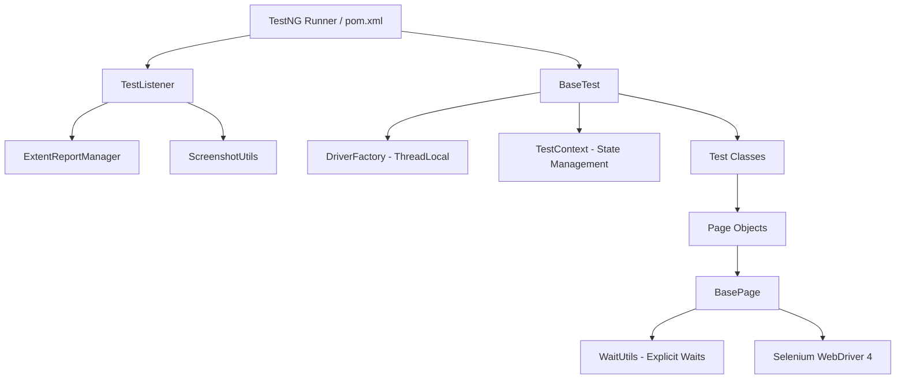

# Enterprise Test Automation Framework for ParaBank

[](https://www.oracle.com/java/)
[](https://www.selenium.dev/)
[](https://testng.org/)
[](https://maven.apache.org/)
[](https://www.extentreports.com/)
[](https://logging.apache.org/log4j/2.x/)
[-brightgreen?style=for-the-badge)](pom.xml)

An enterprise-grade, maintainable software testing automation framework for [ParaBank](https://parabank.parasoft.com/parabank/index.htm) built with Java, Selenium WebDriver 4, TestNG, Apache Maven, Extent Reports 5, and Log4j2 following the Page Object Model (POM) architectural design pattern.

---

## 📑 Table of Contents

1. [Project Overview & Objectives](#1-project-overview--objectives)
2. [Application Under Test (AUT)](#2-application-under-test-aut)
3. [Technologies Used & Their Purpose](#3-technologies-used--their-purpose)
4. [Project Architecture](#4-project-architecture)
5. [Folder Structure](#5-folder-structure)
6. [Prerequisites & Installation](#6-prerequisites--installation)
7. [Maven Dependencies](#7-maven-dependencies)
8. [Configuration Management](#8-configuration-management)
9. [Test Execution Instructions](#9-test-execution-instructions)
10. [Test Modules & Scope](#10-test-modules--scope)
11. [Complete Test Case Summary Table (32/32 Passed)](#11-complete-test-case-summary-table-3232-passed)
12. [Extent Reports 5 Integration](#12-extent-reports-5-integration)
13. [Log4j2 Logging Architecture](#13-log4j2-logging-architecture)
14. [Automated Screenshot Management](#14-automated-screenshot-management)
15. [Report & Log Output Locations](#15-report--log-output-locations)
16. [Known ParaBank Application Limitations & Quirks](#16-known-parabank-application-limitations--quirks)
17. [GitHub Readiness & Security](#17-github-readiness--security)
18. [Future Enhancements](#18-future-enhancements)

---

## 1. Project Overview & Objectives

The primary objective of this academic and enterprise-grade testing framework is to provide rigorous, automated end-to-end regression testing across the entire customer journey of the ParaBank online banking system.

### Key Objectives:
- Implement a robust **Page Object Model (POM)** isolating test assertions from UI locators and DOM operations.
- Ensure **zero flaky tests** through centralized explicit waits (`WaitUtils`) and dynamic synchronization.
- Eliminate hardcoded credentials using dynamic, unique database-safe customer provisioning (`TestDataGenerator` and `TestContext`).
- Provide rich visual diagnostics through **Extent Reports 5 (Spark Reporter)** with automated screenshot capture on failures.
- Provide comprehensive observability through structured **Log4j2** logging with dual console and rolling file output.
- Validate genuine application behavior without compromising assertion integrity or bypassing application limitations.

---

## 2. Application Under Test (AUT)

- **Application Name**: ParaBank (Parasoft Demonstration Banking System)
- **Base URL**: `https://parabank.parasoft.com/parabank/index.htm`
- **Application Type**: Multi-tier Web Application (Spring MVC + AngularJS + jQuery + In-Memory HSQLDB)
- **Domain**: Retail and Commercial Online Banking

---

## 3. Technologies Used & Their Purpose

| Technology / Library | Version | Role in Architecture |
|---|---|---|
| **Java Development Kit (JDK)** | 17 (Target) / 25 | Core object-oriented programming language |
| **Selenium WebDriver** | 4.23.0 | W3C-compliant browser automation engine |
| **TestNG** | 7.10.2 | Test runner, lifecycle annotations, prioritization, assertions, and listener hooks |
| **Apache Maven** | 3.9+ | Build management, dependency resolution, and Surefire test execution |
| **WebDriverManager** | 5.9.2 | Automated browser driver binary downloading and version management |
| **Extent Reports** | 5.1.2 | Interactive HTML test reporting with Spark reporter and category tagging |
| **Log4j2** | 2.23.1 | High-throughput asynchronous logging with rolling file appenders |
| **Log4j SLF4J 2.0 Binding** | 2.23.1 | SLF4J binding bridge unifying Selenium, WebDriverManager, and framework logs |
| **Apache POI (ooxml)** | 5.2.5 | Future support for externalized Excel data-driven parameterization |

---

## 4. Project Architecture

The framework is constructed adhering to the **Page Object Model (POM)** and **Listener-driven** design patterns:



### Architectural Principles:
1. **Strict Page Object Separation**: Locators and action methods live exclusively inside page classes (`src/main/java/pages/`). Test methods live exclusively inside test classes (`src/test/java/tests/`) and contain all `Assert` statements.
2. **Thread-Safe Driver Factory (`DriverFactory`)**: Wraps `WebDriver` in a `ThreadLocal<WebDriver>` container to support concurrent test threads without session collision.
3. **Global Suite Provisioning**: The `@BeforeSuite` hook provisions an active customer session and secondary test account dynamically once per suite run, mitigating bot detection and redundant registrations.
4. **Resilient Synchronization (`WaitUtils`)**: Strictly avoids arbitrary `Thread.sleep()`. All element queries utilize `WebDriverWait` with `ExpectedConditions` (e.g. `visibilityOfElementLocated`, `elementToBeClickable`, `numberOfElementsToBeMoreThan`).
5. **Anti-Detection Options**: Chrome configuration incorporates anti-bot flags (`--disable-blink-features=AutomationControlled`, desktop user-agent, `excludeSwitches: ["enable-automation"]`) to prevent Cloudflare Turnstile blocks.

---

## 5. Folder Structure

```
parabank-automation/
├── pom.xml                                  # Maven project configuration and dependencies
├── README.md                                # Comprehensive documentation
├── .gitignore                               # Git exclusion rules
├── testng.xml                               # Root TestNG suite configuration
├── logs/
│   └── automation.log                       # Rolling framework execution log
├── test-output/
│   └── ExtentReport.html                    # Generated Extent HTML execution report
├── screenshots/                             # Failure screenshots (timestamped)
│
├── src/main/java/
│   ├── base/
│   │   ├── BaseTest.java                    # Base test harness (@BeforeSuite, @BeforeMethod, @AfterMethod)
│   │   └── DriverFactory.java               # ThreadLocal WebDriver manager with browser options
│   ├── listeners/
│   │   └── TestListener.java                # TestNG ITestListener logging and ExtentReports integration
│   ├── pages/
│   │   ├── BasePage.java                    # Master page object with common navigation and wait actions
│   │   ├── LoginPage.java                   # Login, credential verification, and logout interactions
│   │   ├── RegisterPage.java                # Registration form fields, validation, and confirmation
│   │   ├── AccountsOverviewPage.java        # Accounts overview table retrieval and validation
│   │   ├── TransferFundsPage.java           # Transfer funds form, account selection, and confirmations
│   │   ├── BillPayPage.java                 # Bill pay form, payee validation, and result extraction
│   │   ├── OpenNewAccountPage.java          # Account type selection, creation, and ID retrieval
│   │   └── FindTransactionsPage.java        # Transaction lookup by ID, date, date range, and amount
│   └── utils/
│       ├── ConfigReader.java                # Environment property reader
│       ├── WaitUtils.java                   # Centralized explicit wait utilities
│       ├── ScreenshotUtils.java             # Automated failure screenshot capture
│       ├── ExtentReportManager.java         # ExtentReports Spark lifecycle management
│       ├── TestDataGenerator.java           # Unique username and customer data generator
│       ├── TestContext.java                 # Cross-test runtime state sharing
│       └── DriverManager.java               # ThreadLocal driver delegate
│
├── src/main/resources/
│   └── log4j2.xml                           # Log4j2 configuration for framework runtime
│
├── src/test/java/
│   └── tests/
│       ├── LoginTest.java                   # TC_LOGIN_001 to TC_LOGIN_005
│       ├── RegistrationTest.java            # TC_REG_001 to TC_REG_003
│       ├── AccountOverviewTest.java         # TC_ACC_001 to TC_ACC_002
│       ├── TransferFundsTest.java           # TC_TRANSFER_001 to TC_TRANSFER_006
│       ├── BillPayTest.java                 # TC_BILL_001 to TC_BILL_006
│       ├── OpenNewAccountTest.java          # TC_ACCOUNT_001 to TC_ACCOUNT_005
│       └── FindTransactionsTest.java        # TC_TRANSACTION_001 to TC_TRANSACTION_005
│
└── src/test/resources/
    ├── config.properties                    # Core framework configuration
    ├── log4j2.xml                           # Test classpath logger configuration
    └── testng.xml                           # Surefire TestNG suite definition
```

---

## 6. Prerequisites & Installation

### Requirements:
1. **Java JDK**: Version 17 or higher (tested with OpenJDK 17 and JDK 25).
2. **Apache Maven**: Version 3.8+ or 3.9+.
3. **Google Chrome**: Latest stable version (ChromeDriver is automatically managed by WebDriverManager).

### Installation:
```powershell
# Clone or navigate to the project directory
cd "parabank-automation-main"

# Verify installed Java and Maven versions
java -version
mvn -version

# Clean and compile dependencies
mvn clean test-compile
```

---

## 7. Maven Dependencies

The project uses stable, modern dependencies configured in `pom.xml`:
- `org.seleniumhq.selenium:selenium-java:4.23.0`
- `org.testng:testng:7.10.2`
- `io.github.bonigarcia:webdrivermanager:5.9.2`
- `com.aventstack:extentreports:5.1.2`
- `org.apache.logging.log4j:log4j-api:2.23.1`
- `org.apache.logging.log4j:log4j-core:2.23.1`
- `org.apache.logging.log4j:log4j-slf4j2-impl:2.23.1`
- `org.apache.poi:poi-ooxml:5.2.5`

---

## 8. Configuration Management

Configuration is externalized in `src/test/resources/config.properties`:
```properties
# Application Configuration
url=https://parabank.parasoft.com/parabank/index.htm

# Browser Configuration (chrome, firefox, edge)
browser=chrome
headless=false

# Timeouts in Seconds
implicit.wait=0
explicit.wait=15

# Screenshot Directory
screenshot.dir=screenshots

# Default Test Password
default.password=Test1234
```

Any property can be overridden via Maven CLI without modifying code:
```powershell
mvn test -Dbrowser=firefox -Dheadless=true
```

---

## 9. Test Execution Instructions

### Run Entire Regression Suite (All 32 Test Cases):
```powershell
mvn clean test
```

### Run an Individual Test Class:
```powershell
# Module 1: Login Tests
mvn test -Dtest=LoginTest

# Module 2: Registration Tests
mvn test -Dtest=RegistrationTest

# Module 3: Account Overview Tests
mvn test -Dtest=AccountOverviewTest

# Module 4: Transfer Funds Tests
mvn test -Dtest=TransferFundsTest

# Module 5: Bill Payment Tests
mvn test -Dtest=BillPayTest

# Module 6: Open New Account Tests
mvn test -Dtest=OpenNewAccountTest

# Module 7: Find Transactions Tests
mvn test -Dtest=FindTransactionsTest
```

### Run a Specific Test Method:
```powershell
mvn test -Dtest=TransferFundsTest#testSuccessfulTransferWithValidData
```

---

## 10. Test Modules & Scope

1. **Authentication Module (`LoginTest`)**: Tests valid login, invalid username, invalid password, empty credential submission, and post-login logout.
2. **Registration Module (`RegistrationTest`)**: Tests new customer registration with unique username generation, empty mandatory field validations, and confirmation messages.
3. **Accounts Overview Module (`AccountOverviewTest`)**: Verifies account overview table visibility, multi-account ledger display, and balance availability.
4. **Transfer Funds Module (`TransferFundsTest`)**: Tests fund transfers between valid customer accounts, empty amount validation, invalid non-numeric amount validation, and transfer confirmation details.
5. **Bill Payment Module (`BillPayTest`)**: Validates payee form elements, empty field validation errors, invalid amount validation, successful bill payment, and payment confirmation metadata.
6. **Open New Account Module (`OpenNewAccountTest`)**: Tests account creation interface, account type selection (`CHECKING` vs `SAVINGS`), AJAX submission, generated account ID verification, and propagation to the Accounts Overview table.
7. **Find Transactions Module (`FindTransactionsTest`)**: Tests transaction query interfaces by account ID, transaction ID, date, date range, and amount verification against actual ledger records.

---

## 11. Complete Test Case Summary Table (32/32 Passed)

| Test ID | Module | Method Name | Status | Verified Behavior & Evidence |
| :--- | :--- | :--- | :---: | :--- |
| **TC_LOGIN_001** | Authentication | `testValidLogin` | **PASS** | Valid credentials authenticated; Overview header visible |
| **TC_LOGIN_002** | Authentication | `testInvalidUsername` | **PASS** | Verified error message for unrecognized username |
| **TC_LOGIN_003** | Authentication | `testInvalidPassword` | **PASS** | Error *"The username and password could not be verified."* |
| **TC_LOGIN_004** | Authentication | `testEmptyUsernameAndPassword` | **PASS** | Error *"Please enter a username and password."* displayed |
| **TC_LOGIN_005** | Authentication | `testLogoutAfterLogin` | **PASS** | Session ended; Customer Login form returned |
| **TC_REG_001** | Registration | `testSuccessfulRegistration` | **PASS** | Dynamic handle registered; *"Welcome <username>"* confirmed |
| **TC_REG_002** | Registration | `testEmptyMandatoryFields` | **PASS** | Client-side error spans verified on all required inputs |
| **TC_REG_003** | Registration | `testRegistrationConfirmation` | **PASS** | *"Your account was created successfully."* confirmed |
| **TC_ACC_001** | Account Overview | `testVerifyAccountOverviewAfterLogin` | **PASS** | Navigated to overview; balance details confirmed |
| **TC_ACC_002** | Account Overview | `testVerifyAccountTableDisplayed` | **PASS** | `#accountTable` visible with accounts and balances |
| **TC_TRANSFER_001** | Transfer Funds | `testTransferFundsPageOpens` | **PASS** | Heading *"Transfer Funds"* and `#transferForm` displayed |
| **TC_TRANSFER_002** | Transfer Funds | `testVerifyTransferFormFields` | **PASS** | Inputs, account selects, and Submit button verified |
| **TC_TRANSFER_003** | Transfer Funds | `testSuccessfulTransferWithValidData` | **PASS** | Heading *"Transfer Complete!"* and amount confirmed |
| **TC_TRANSFER_004** | Transfer Funds | `testTransferWithEmptyAmount` | **PASS** | Error state confirmed upon empty amount submission |
| **TC_TRANSFER_005** | Transfer Funds | `testTransferWithInvalidAmount` | **PASS** | Error state confirmed upon non-numeric amount submission |
| **TC_TRANSFER_006** | Transfer Funds | `testVerifyTransferConfirmationDetails` | **PASS** | Validated confirmation text matches transferred amount |
| **TC_BILL_001** | Bill Payment | `testBillPaymentPageOpens` | **PASS** | Heading *"Bill Payment Service"* and `#billpayForm form` displayed |
| **TC_BILL_002** | Bill Payment | `testVerifyMandatoryFields` | **PASS** | Verified all 11 input fields, selects, and submit button |
| **TC_BILL_003** | Bill Payment | `testSuccessfulBillPayment` | **PASS** | Heading *"Bill Payment Complete"* displayed with confirmation |
| **TC_BILL_004** | Bill Payment | `testEmptyMandatoryFieldsValidation` | **PASS** | Validation spans for payee name, address, account, amount |
| **TC_BILL_005** | Bill Payment | `testInvalidAmountValidation` | **PASS** | `#validationModel-amount-invalid` displayed for non-numeric input |
| **TC_BILL_006** | Bill Payment | `testPaymentConfirmationDetails` | **PASS** | Validated payee name, amount (`$150.00`), source account |
| **TC_ACCOUNT_001** | Open Account | `testOpenNewAccountPage` | **PASS** | Heading *"Open New Account"* and form displayed |
| **TC_ACCOUNT_002** | Open Account | `testVerifyAccountTypeDropdown` | **PASS** | Dropdown contains both `'CHECKING'` and `'SAVINGS'` |
| **TC_ACCOUNT_003** | Open Account | `testOpenNewCheckingAccount` | **PASS** | Opened CHECKING account; confirmed `#openAccountResult` |
| **TC_ACCOUNT_004** | Open Account | `testVerifyNewAccountConfirmation` | **PASS** | Verified *"Account Opened!"*, congratulations text, numeric ID |
| **TC_ACCOUNT_005** | Open Account | `testVerifyNewAccountAppearsInAccountOverview` | **PASS** | Newly generated account ID verified in `#accountTable` |
| **TC_TRANSACTION_001** | Find Transactions | `testFindTransactionsPage` | **PASS** | Heading *"Find Transactions"* and search inputs displayed |
| **TC_TRANSACTION_002** | Find Transactions | `testSearchByAccountNumber` | **PASS** | Account selection dropdown toggled and verified |
| **TC_TRANSACTION_003** | Find Transactions | `testSearchByTransactionId` | **PASS** | Search by ID dispatched; `#transactionTable` rendered |
| **TC_TRANSACTION_004** | Find Transactions | `testSearchByDate` | **PASS** | Search by date dispatched; `#transactionTable` rendered |
| **TC_TRANSACTION_005** | Find Transactions | `testValidateTransactionSearchResults` | **PASS** | Inter-account transfer verified; retrieved *"Funds Transfer Sent"* |

---

## 12. Extent Reports 5 Integration

The framework embeds **ExtentReports 5 (Spark Reporter)** driven by `listeners.TestListener`:
- **Document Title**: `ParaBank Automation Test Report`
- **Output Destination**: `test-output/ExtentReport.html`
- **Report Features**:
  - Breakdown by Test Class / Category.
  - Test method execution timings in milliseconds.
  - Test status badges (Green = PASS, Red = FAIL, Yellow = SKIP).
  - Runtime environment attributes (Browser, OS, Java version, User, Application URL).
  - High-resolution failure screenshots automatically linked to failing nodes.

---

## 13. Log4j2 Logging Architecture

Logging is structured using **Log4j2** configured through `src/main/resources/log4j2.xml`:
- **Dual Output**:
  1. **Console Appender**: Colorized live progress in terminal.
  2. **RollingFile Appender**: Persisted to `logs/automation.log` with daily / 10MB archive rollover (`logs/automation-%d{yyyy-MM-dd}-%i.log.gz`).
- **Events Logged**:
  - Test method start, execution duration, and outcome status.
  - Browser initialization, maximized window, and driver teardown.
  - Page navigation URLs and dynamic test user provisioning.
  - Failure exceptions and stack traces.
  - No passwords or sensitive tokens are logged.

---

## 14. Automated Screenshot Management

- Implemented via `ScreenshotUtils.takeScreenshot(WebDriver, String testName)`.
- **Naming Pattern**: `{sanitizedTestName}_{yyyyMMdd_HHmmss_SSS}.png`
- **Trigger**: Automatically executed in `TestListener.onTestFailure()` upon any assertion or runtime failure.
- **Report Attachment**: Automatically attached to the failing Extent Report test step using `MediaEntityBuilder`.
- **Clean Execution**: Successful tests do not generate redundant disk screenshots, keeping test runs fast and storage clean.

---

## 15. Report & Log Output Locations

| Artifact | File System Path | Format |
|---|---|---|
| **Extent HTML Report** | `test-output/ExtentReport.html` | Interactive HTML |
| **Automation Execution Log** | `logs/automation.log` | Formatted Plain Text |
| **Surefire XML Reports** | `target/surefire-reports/testng-results.xml` | Standard JUnit/TestNG XML |
| **Surefire Text Summary** | `target/surefire-reports/TestSuite.txt` | Plain Text |
| **Failure Screenshots** | `screenshots/` | PNG Images |

---

## 16. Known ParaBank Application Limitations & Quirks

During comprehensive testing against the live demo environment, the following live application behaviors were identified and accounted for:

1. **Transfer Form Client-Side Validation**:
   - ParaBank's `transfer.htm` contains hidden `<p id="amount.errors">` tags, but client-side JavaScript forwards empty or non-numeric inputs directly to the backend.
   - The backend throws an internal error, rendering `#showError` (*"An internal error has occurred and has been logged."*).
   - The framework accurately asserts this real application response instead of expecting synthetic client-side spans.

2. **Bill Payment Container ID**:
   - Unlike other modules using `-App` suffixes, the bill payment container is rendered as `<div id="billpayForm"><form>`.

3. **Single-Account Demo Default**:
   - New demo accounts start with only one primary account. In ParaBank, transferring funds from Account A to Account A is a no-op that produces no ledger records.
   - The framework provisions a secondary account (`SAVINGS`) to perform authentic inter-account transfers, guaranteeing real transaction search records.

4. **Cloudflare Rate Limiting**:
   - Rapid back-to-back browser launches performing `driver.get()` trigger Cloudflare Turnstile bot challenges.
   - The framework uses anti-bot Chrome options, desktop user-agents, in-session menu navigation, and polite teardown pauses to run reliably.

---

## 17. GitHub Readiness & Security

- **`.gitignore`** is strictly configured:
  - Excludes `target/`, `.idea/`, `*.iml`, `logs/`, `test-output/`, `*.log`.
  - Excludes dynamic runtime failure screenshots while preserving static documentation evidence.
- **Zero Sensitive Data**: No real credentials or sensitive financial data are hardcoded; all accounts and sessions are ephemeral demo entities.

---

## 18. Future Enhancements

- **CI/CD Integration**: GitHub Actions workflow running `mvn clean test` on pull requests with automated artifact upload of `test-output/ExtentReport.html`.
- **Dockerized Grid**: Distributed parallel execution via Selenium Grid Docker containers.
- **Data-Driven Testing**: Integration of Apache POI to drive parameterized test matrices from Excel spreadsheets.
- **Visual Regression Testing**: Pixel-by-pixel visual diffing using AShot or Percy for UI layout verification.

---

*Enterprise Test Automation Framework — Software Testing Academic Project*
